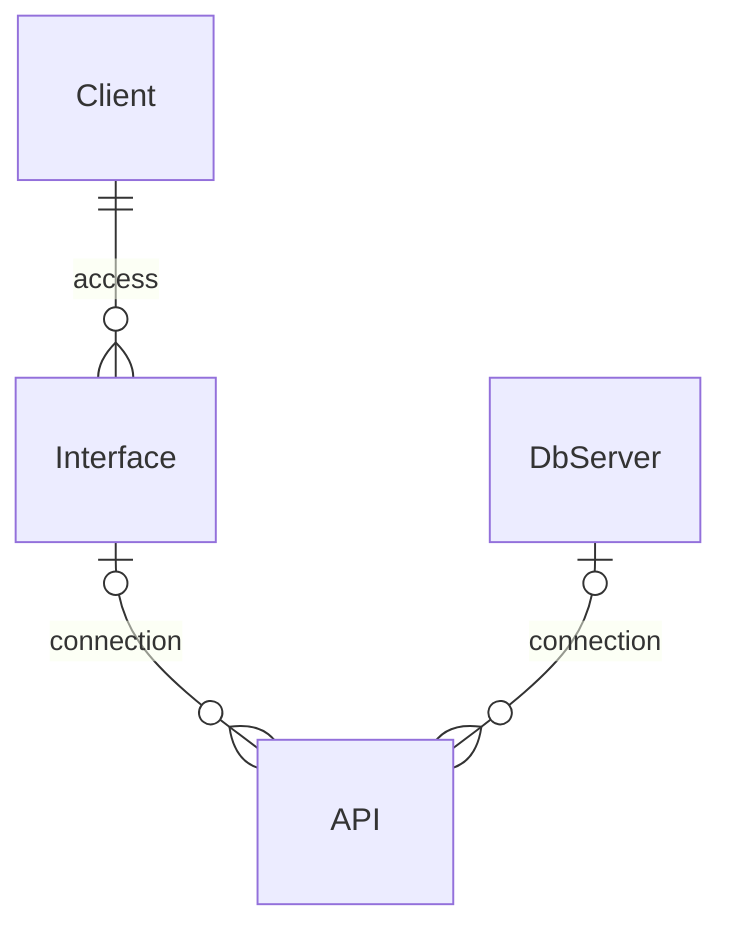

# Qwizzi

Qwizzi is a web application designed for creating and participating in universe full of quizzes. Quizzes with different topics, with education or adventure purposes.

# Technology stack

Qwizzi runs on ASP.NET REST API Backend with database Postgresql server. All of it is setup on React frontend.

# Main system requirements

- Unix or Windows operating system.
- System with docker containers and kubernetez support.
- Node.JS minimum 14.0.0 ver.
- .NET 10+.

You can download required runtime environments here:

- Node.JS: https://nodejs.org/en/download/current.
- .NET SDK: https://dotnet.microsoft.com/en-us/download.

# Developer and testing environment

This section describes how to setup developer or testing environment. Here you need to manually add credentians, update database, install dependencies and run two apps: one on backend and one on frontend.

## Requirements

> 1. Go to `app/api/Qwizzi/src/Qwizzi.Api`.
> 2. Copy developer or tester connection string from `(developer/testing).env.example` or create your own config: `dotnet user-secrets set "ConnectionStrings" "(string)"`.

## How to run?

> 1. In the repo root run `docker compose -f docker-compose.(developer/testing).yml --env-file .env.(developer/testing) up -d --build`.
> 2. Go to `app/api/Qwizzi/src/Qwizzi.Api`.
> 3. Update existing migrations to database, run: `dotnet ef database update`.
> 4. Run dotnet application: `dotnet run` or for hot-reload: `dotnet watch run`.
> 5. Navigate now to `app/client/Qwizzi`.
> 6. Install dependencies: `npm ci`.
> 7. Run React app: `npm run dev`.
