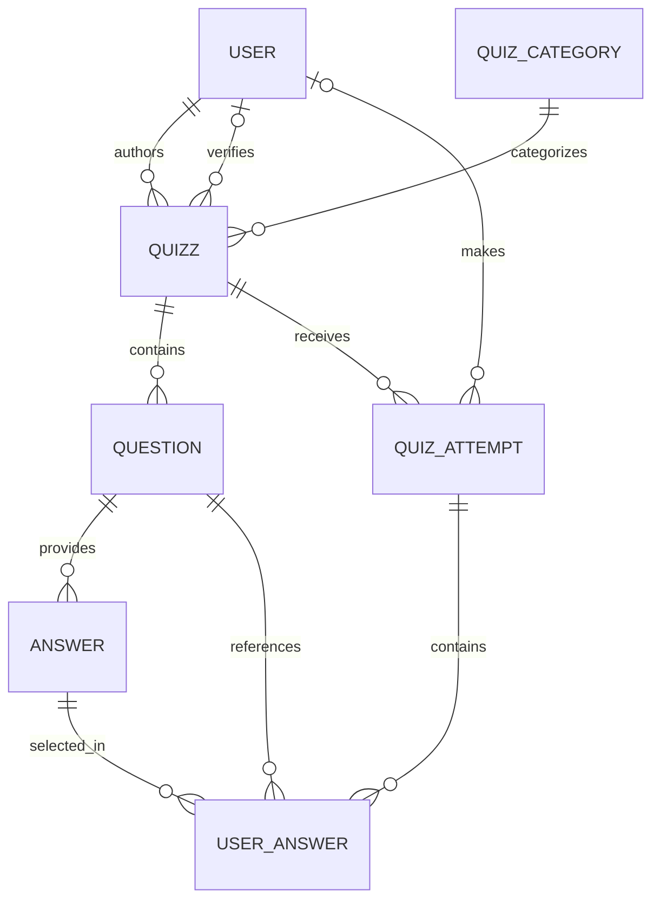
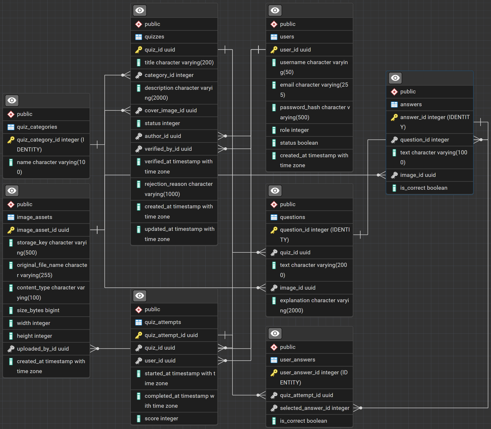

# Database Model

Qwizzi uses a containerized PostgreSQL database to store user accounts, quiz categories, quiz definitions, verification details, quiz attempts, and submitted answers.

The application schema contains seven tables connected through ten one-to-many relationships. This count excludes infrastructure tables such as the EF Core migrations history table.

## Entity Overview

| Entity         | Table             | Purpose                                                                          |
| -------------- | ----------------- | -------------------------------------------------------------------------------- |
| `User`         | `users`           | Stores user accounts and roles.                                                  |
| `QuizCategory` | `quiz_categories` | Stores categories used to organize quizzes.                                      |
| `Quiz`         | `quizzes`         | Stores quiz metadata, category assignment, authorship, and verification details. |
| `Question`     | `questions`       | Stores questions belonging to a quiz.                                            |
| `Answer`       | `answers`         | Stores the answer options available for a question.                              |
| `QuizAttempt`  | `quiz_attempts`   | Represents an individual attempt to complete a quiz.                             |
| `UserAnswer`   | `user_answers`    | Records an answer selected during a quiz attempt.                                |

## Entity Relationship Diagram



Each child record references exactly one parent unless the relationship is explicitly optional.

A parent may exist without child records. For example:

- A draft quiz may initially contain no questions.
- A category may exist without any assigned quizzes.
- A registered user may have no quiz attempts.

## Schema Relationship

Referenced in pgAdmin4 ERD for database:



## Relationships

### 1. User → Authored Quizzes

```text
users.id ← quizzes.author_id
```

A user can author multiple quizzes. Each quiz must reference one author.

| Property        | Value               |
| --------------- | ------------------- |
| Cardinality     | One-to-many         |
| Foreign key     | `quizzes.author_id` |
| Optional        | No                  |
| Delete behavior | `Restrict`          |

Navigation properties:

```csharp
User.CreatedQuizzes
Quiz.Author
```

EF Core configuration:

```csharp
builder.HasOne(quiz => quiz.Author)
    .WithMany(user => user.CreatedQuizzes)
    .HasForeignKey(quiz => quiz.AuthorId)
    .OnDelete(DeleteBehavior.Restrict);
```

Deleting a user is blocked while quizzes still reference that user as their author. These relationships must be resolved before the account can be physically deleted.

### 2. User → Verified Quizzes

```text
users.id ← quizzes.verified_by_id
```

A user can verify multiple quizzes. A quiz may reference one verifier or none.

| Property        | Value                    |
| --------------- | ------------------------ |
| Cardinality     | One-to-many              |
| Foreign key     | `quizzes.verified_by_id` |
| Optional        | Yes                      |
| Delete behavior | `SetNull`                |

Navigation property:

```csharp
Quiz.VerifiedBy
```

EF Core configuration:

```csharp
builder.HasOne(quiz => quiz.VerifiedBy)
    .WithMany()
    .HasForeignKey(quiz => quiz.VerifiedById)
    .OnDelete(DeleteBehavior.SetNull);
```

There is no inverse collection of verified quizzes on `User`.

Deleting the verifier sets `verified_by_id` to `NULL` without deleting the quiz. This does not automatically reset the quiz status, verification timestamp, or rejection reason.

The relationship records who performed verification. Checking that the user has the `Administrator` role is an application responsibility.

The author and verifier are separate relationships to the same table:

| Foreign key      | Meaning                         |
| ---------------- | ------------------------------- |
| `author_id`      | The user who created the quiz.  |
| `verified_by_id` | The user who verified the quiz. |

The current model does not prevent an author from also being the verifier.

### 3. Quiz Category → Quizzes

```text
quiz_categories.id ← quizzes.category_id
```

A category can contain multiple quizzes. Each quiz must belong to exactly one category.

| Property        | Value                 |
| --------------- | --------------------- |
| Cardinality     | One-to-many           |
| Foreign key     | `quizzes.category_id` |
| Optional        | No                    |
| Delete behavior | `Restrict`            |

Navigation properties:

```csharp
QuizCategory.Quizzes
Quiz.Category
```

EF Core configuration in `QuizConfiguration`:

```csharp
builder.Property(quiz => quiz.CategoryId)
    .HasColumnName("category_id")
    .IsRequired();

builder.HasOne(quiz => quiz.Category)
    .WithMany(category => category.Quizzes)
    .HasForeignKey(quiz => quiz.CategoryId)
    .OnDelete(DeleteBehavior.Restrict);
```

Example:

```text
Category: Programming
├── Quiz: C# Basics
├── Quiz: PostgreSQL Fundamentals
└── Quiz: ASP.NET Core
```

Deleting a category is blocked while quizzes reference it. Quizzes must be reassigned or otherwise removed from the category before it can be deleted.

Deleting a quiz does not delete its category.

The current model supports one category per quiz, not multiple categories per quiz.

#### Category Properties

| Property | Database column | Configuration                                   |
| -------- | --------------- | ----------------------------------------------- |
| `Id`     | `id`            | Integer primary key, generated on insert.       |
| `Name`   | `name`          | Required, maximum 100 characters, unique index. |

EF Core configuration in `QuizCategoryConfiguration`:

```csharp
builder.ToTable("quiz_categories");

builder.HasKey(category => category.Id);

builder.Property(category => category.Id)
    .HasColumnName("id")
    .ValueGeneratedOnAdd();

builder.Property(category => category.Name)
    .HasColumnName("name")
    .HasMaxLength(100)
    .IsRequired();

builder.HasIndex(category => category.Name)
    .IsUnique();
```

Category identifiers use `int`, while quiz identifiers remain `Guid`. The foreign key `Quiz.CategoryId` matches the category's integer key.

### 4. Quiz → Questions

```text
quizzes.id ← questions.quiz_id
```

A quiz can contain multiple questions. Each question belongs to exactly one quiz.

| Property        | Value               |
| --------------- | ------------------- |
| Cardinality     | One-to-many         |
| Foreign key     | `questions.quiz_id` |
| Optional        | No                  |
| Delete behavior | `Cascade`           |

Navigation properties:

```csharp
Quiz.Questions
Question.Quiz
```

EF Core configuration:

```csharp
builder.HasMany(quiz => quiz.Questions)
    .WithOne(question => question.Quiz)
    .HasForeignKey(question => question.QuizId)
    .OnDelete(DeleteBehavior.Cascade);
```

Deleting a quiz is configured to cascade to its questions. However, references from recorded user answers can restrict deletion.

This relationship does not enforce a minimum number of questions.

### 5. Question → Answer Options

```text
questions.id ← answers.question_id
```

A question can provide multiple answer options. Each option belongs to exactly one question.

| Property        | Value                 |
| --------------- | --------------------- |
| Cardinality     | One-to-many           |
| Foreign key     | `answers.question_id` |
| Optional        | No                    |
| Delete behavior | `Cascade`             |

Navigation properties:

```csharp
Question.Answers
Answer.Question
```

EF Core configuration:

```csharp
builder.HasMany(question => question.Answers)
    .WithOne(answer => answer.Question)
    .HasForeignKey(answer => answer.QuestionId)
    .OnDelete(DeleteBehavior.Cascade);
```

Deleting a question is configured to cascade to its answer options. Options referenced by submitted answers are protected by a restrictive foreign key.

The relationship does not enforce:

- A minimum number of answer options.
- A maximum number of answer options.
- Exactly one correct option.
- At least one correct option.

These rules must be defined and enforced separately.

### 6. Quiz → Quiz Attempts

```text
quizzes.id ← quiz_attempts.quiz_id
```

A quiz can have multiple attempts. Each attempt targets exactly one quiz.

| Property        | Value                   |
| --------------- | ----------------------- |
| Cardinality     | One-to-many             |
| Foreign key     | `quiz_attempts.quiz_id` |
| Optional        | No                      |
| Delete behavior | `Cascade`               |

Navigation properties:

```csharp
Quiz.Attempts
QuizAttempt.Quiz
```

EF Core configuration:

```csharp
builder.HasOne(attempt => attempt.Quiz)
    .WithMany(quiz => quiz.Attempts)
    .HasForeignKey(attempt => attempt.QuizId)
    .OnDelete(DeleteBehavior.Cascade);
```

Deleting a quiz is configured to delete its attempts. Deleting those attempts also cascades to their submitted answers.

The current model allows repeated attempts at the same quiz by the same user.

### 7. User → Quiz Attempts

```text
users.id ← quiz_attempts.user_id
```

A registered user can have multiple quiz attempts. An attempt may belong to a user or remain anonymous.

| Property        | Value                   |
| --------------- | ----------------------- |
| Cardinality     | One-to-many             |
| Foreign key     | `quiz_attempts.user_id` |
| Optional        | Yes                     |
| Delete behavior | `SetNull`               |

Navigation properties:

```csharp
User.QuizAttempts
QuizAttempt.User
```

EF Core configuration:

```csharp
builder.HasOne(attempt => attempt.User)
    .WithMany(user => user.QuizAttempts)
    .HasForeignKey(attempt => attempt.UserId)
    .OnDelete(DeleteBehavior.SetNull);
```

A `NULL` user reference supports guest participation.

Deleting a user clears the reference on their attempts while preserving the attempts and submitted answers, provided other relationships do not prevent account deletion.

The current model does not distinguish a guest attempt from an attempt whose user account was subsequently deleted.

### 8. Quiz Attempt → Submitted Answers

```text
quiz_attempts.id ← user_answers.quiz_attempt_id
```

A quiz attempt can contain multiple submitted answers. Each submitted answer belongs to exactly one attempt.

| Property        | Value                          |
| --------------- | ------------------------------ |
| Cardinality     | One-to-many                    |
| Foreign key     | `user_answers.quiz_attempt_id` |
| Optional        | No                             |
| Delete behavior | `Cascade`                      |

Navigation properties:

```csharp
QuizAttempt.UserAnswers
UserAnswer.QuizAttempt
```

EF Core configuration:

```csharp
builder.HasOne(userAnswer => userAnswer.QuizAttempt)
    .WithMany(attempt => attempt.UserAnswers)
    .HasForeignKey(userAnswer => userAnswer.QuizAttemptId)
    .OnDelete(DeleteBehavior.Cascade);
```

Deleting an attempt deletes its submitted answers. It does not delete the underlying questions or answer options.

The current configuration does not enforce one submission per question per attempt.

If this rule is required, the following unique index can be added:

```csharp
builder.HasIndex(userAnswer => new
    {
        userAnswer.QuizAttemptId,
        userAnswer.QuestionId
    })
    .IsUnique();
```

This index is a proposed constraint, not part of the configuration documented above.

### 9. Question → Submitted Answers

```text
questions.id ← user_answers.question_id
```

A question can be referenced by multiple submitted answers across different attempts. Each submitted answer references exactly one question.

| Property        | Value                      |
| --------------- | -------------------------- |
| Cardinality     | One-to-many                |
| Foreign key     | `user_answers.question_id` |
| Optional        | No                         |
| Delete behavior | `Restrict`                 |

Navigation property:

```csharp
UserAnswer.Question
```

EF Core configuration:

```csharp
builder.HasOne(userAnswer => userAnswer.Question)
    .WithMany()
    .HasForeignKey(userAnswer => userAnswer.QuestionId)
    .OnDelete(DeleteBehavior.Restrict);
```

There is no inverse collection of submitted answers on `Question`.

Deleting a question is blocked while submitted answers reference it.

This protects the relationship, not a historical copy of the question. Editing the question changes the definition associated with existing attempts.

### 10. Answer Option → Submitted Answers

```text
answers.id ← user_answers.selected_answer_id
```

An answer option can be selected in multiple attempts. Each submitted answer references exactly one selected option.

| Property        | Value                             |
| --------------- | --------------------------------- |
| Cardinality     | One-to-many                       |
| Foreign key     | `user_answers.selected_answer_id` |
| Optional        | No                                |
| Delete behavior | `Restrict`                        |

Navigation property:

```csharp
UserAnswer.SelectedAnswer
```

EF Core configuration:

```csharp
builder.HasOne(userAnswer => userAnswer.SelectedAnswer)
    .WithMany()
    .HasForeignKey(userAnswer => userAnswer.SelectedAnswerId)
    .OnDelete(DeleteBehavior.Restrict);
```

There is no inverse collection of submissions on `Answer`.

Deleting an answer option is blocked while submitted answers reference it.

Each `UserAnswer` records one selected option. Unanswered questions can be represented by the absence of a submission. The current structure does not directly represent multiple selected options within a single submission.

## Persistence Configuration

Domain entities are defined in `Qwizzi.Domain.Entities`.

Database mappings are defined in `Qwizzi.Infrastructure.Persistence.Configurations` using `IEntityTypeConfiguration<T>`.

```text
Qwizzi.Infrastructure/
└── Persistence/
    ├── AppDbContext.cs
    ├── Configurations/
    │   ├── AnswerConfiguration.cs
    │   ├── QuestionConfiguration.cs
    │   ├── QuizCategoryConfiguration.cs
    │   ├── QuizConfiguration.cs
    │   ├── QuizAttemptConfiguration.cs
    │   ├── UserConfiguration.cs
    │   └── UserAnswerConfiguration.cs
    └── Migrations/
```

`AppDbContext` exposes the following entity sets:

```csharp
public DbSet<User> Users => Set<User>();
public DbSet<Quiz> Quizzes => Set<Quiz>();
public DbSet<QuizCategory> QuizCategories => Set<QuizCategory>();
public DbSet<Question> Questions => Set<Question>();
public DbSet<Answer> Answers => Set<Answer>();
public DbSet<QuizAttempt> QuizAttempts => Set<QuizAttempt>();
public DbSet<UserAnswer> UserAnswers => Set<UserAnswer>();
```

Entity configurations are discovered from the Infrastructure assembly:

```csharp
protected override void OnModelCreating(ModelBuilder modelBuilder)
{
    base.OnModelCreating(modelBuilder);

    modelBuilder.ApplyConfigurationsFromAssembly(
        typeof(AppDbContext).Assembly);
}
```

## Answer Options vs. Submitted Answers

`Answer` defines an available option. `UserAnswer` records a selection made during an attempt.

| Entity       | Meaning of `IsCorrect`                                    |
| ------------ | --------------------------------------------------------- |
| `Answer`     | Whether an option is correct in the quiz definition.      |
| `UserAnswer` | Whether a particular submission was evaluated as correct. |

Example:

```text
Question: What is 2 + 2?

Answer options:
├── 3 → IsCorrect = false
├── 4 → IsCorrect = true
└── 5 → IsCorrect = false

Submitted answer:
├── QuestionId → the question above
├── SelectedAnswerId → the option "4"
└── IsCorrect = true
```

The application must calculate `UserAnswer.IsCorrect` on the server. It should not trust a correctness value supplied by the client.

## Example Data Flow

A typical quiz lifecycle connects the entities as follows:

1. An author creates a `Quiz` and assigns an existing `QuizCategory`.
2. The author adds `Question` records and their `Answer` options.
3. An administrator verifies the quiz.
4. A registered user or guest starts a `QuizAttempt`.
5. Each submitted selection creates a `UserAnswer`.
6. The server evaluates the submitted answers and updates the attempt result.

```text
QuizCategory: Mathematics
└── Quiz: Basic Arithmetic
    ├── AuthorId → author
    ├── VerifiedById → administrator
    │
    ├── Question: "What is 2 + 2?"
    │   ├── Answer: "3"
    │   ├── Answer: "4"
    │   └── Answer: "5"
    │
    └── QuizAttempt
        ├── UserId → registered user or NULL
        └── UserAnswer
            ├── QuestionId → "What is 2 + 2?"
            ├── SelectedAnswerId → "4"
            └── IsCorrect = true
```

## Data Integrity Responsibilities

Foreign keys ensure that referenced records exist. The current configuration does not enforce every business rule.

When creating or updating a quiz, the application must validate its category assignment and other required input. The database rejects category references that do not exist.

Before accepting a submitted answer, the application must verify that:

1. The question belongs to the quiz associated with the attempt.
2. The selected answer option belongs to that question.
3. The attempt is still eligible to accept answers.
4. The submission follows the policy for repeated answers.
5. Correctness and scoring are calculated on the server.

Quiz verification must also enforce administrator permissions and any rules concerning self-verification.

## Category Migration Considerations

The category relationship is required: every quiz must have a valid `category_id`.

When introducing categories into a database that already contains quizzes, existing records must receive a valid category assignment before the required relationship can be enforced.

A suitable migration sequence is:

1. Create the `quiz_categories` table.
2. Add `quizzes.category_id` as nullable.
3. Create a fallback category, such as `Uncategorized`.
4. Assign existing quizzes to that category.
5. Change `quizzes.category_id` to `NOT NULL`.

Existing quizzes must not be left with a category identifier such as `0` unless a matching category actually exists.

This is a migration strategy for existing data; it does not mean that a fallback category is automatically created by the current entity configuration.

## Delete Behavior Summary

| Parent        | Dependent         | Behavior   |
| ------------- | ----------------- | ---------- |
| User          | Authored quizzes  | `Restrict` |
| User          | Verified quizzes  | `SetNull`  |
| Quiz category | Quizzes           | `Restrict` |
| Quiz          | Questions         | `Cascade`  |
| Question      | Answer options    | `Cascade`  |
| Quiz          | Quiz attempts     | `Cascade`  |
| User          | Quiz attempts     | `SetNull`  |
| Quiz attempt  | Submitted answers | `Cascade`  |
| Question      | Submitted answers | `Restrict` |
| Answer option | Submitted answers | `Restrict` |

### Historical Data Considerations

Cascading paths and restrictive references must be considered together.

A quiz deletion should not be assumed to succeed simply because its immediate relationships use `Cascade`. Deletion behavior for quizzes with recorded attempts should be covered by PostgreSQL integration tests.

For quizzes with participation history, archiving is a proposed alternative to physical deletion. The current model does not yet include an archival field or status.

Preserving historical results also requires an explicit editing policy. Restricting deletion alone does not prevent changes to question text, answer options, or correctness.

Possible future extensions include:

- Versioning published quizzes.
- Storing question and answer snapshots for each attempt.
- Preventing edits to published quizzes after the first attempt.
- Introducing an archival state for quizzes that should no longer accept attempts.
